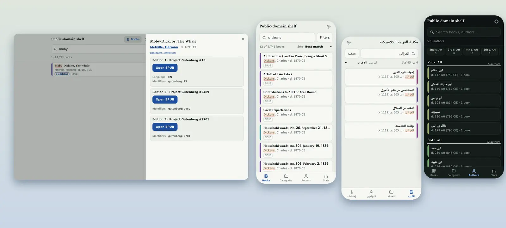
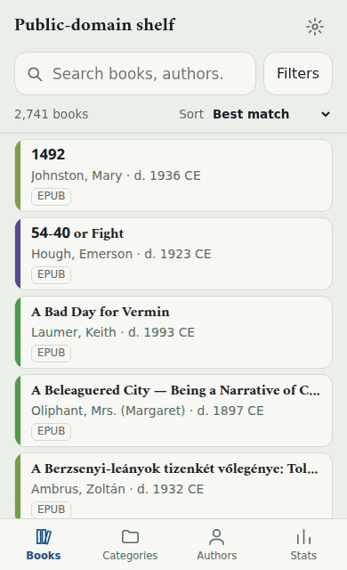
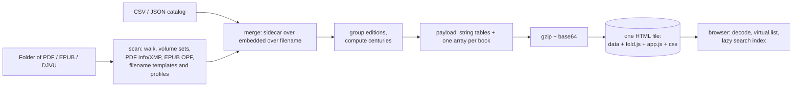
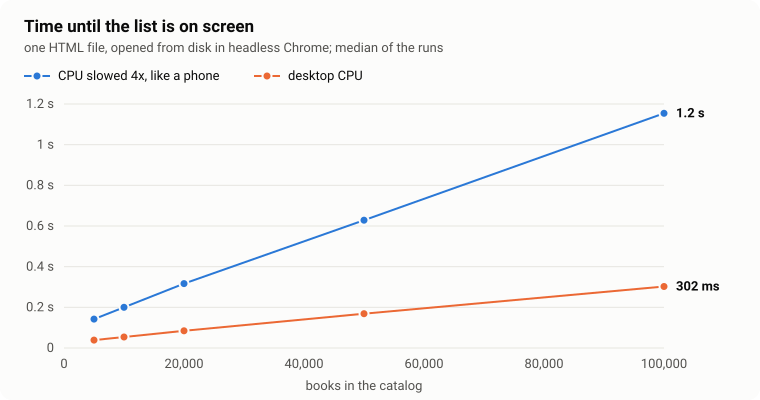

<div align="center">

# pocketshelf

**Your PDFs, EPUBs and DJVUs as one offline HTML file you open from your phone's storage.**<br>
Instant search that ignores accents and Arabic spelling variants, categories, authors by century, editions grouped. No server, no app, no cloud.

[](https://github.com/kmbenjel/pocketshelf/actions/workflows/ci.yml)
[](https://pypi.org/project/pocketshelf/)
[](https://pypi.org/project/pocketshelf/)
[](LICENSE)
[](pyproject.toml)
[](https://warraq.benjelloun.dev/pocketshelf/)



</div>

```bash
uvx pocketshelf build ~/Books        # writes ~/Books/pocketshelf.html  (or: pipx install pocketshelf)
pocketshelf demo --open              # a live sample from public-domain metadata, in under a minute
```

**[Live demo](https://benjelloun.dev/pocketshelf/)** · [Arabic demo](https://benjelloun.dev/pocketshelf/arabic.html) · [Catalog schema](docs/catalog-schema.md) · [Arabic docs](https://warraq.benjelloun.dev/pocketshelf/)

<p align="center"></p>

## Why it exists

A personal library of thousands of PDFs lives on a phone or a USB stick. Browsing it means scrolling a file manager, or running Calibre
on a computer and a server for the phone. Mobile browsers will not follow links between local HTML files, so the usual "static site
of pages" idea breaks on exactly the device where you read.

pocketshelf makes **one file**: the data, the search engine and the interface are all inside it. Put it beside the books, open it from
the phone's storage, and every title is a plain relative link to its PDF. It was built for a 16,700-volume Arabic library on an Android
phone, and rebuilt as a general tool: any language, any folder layout, any catalog.

## Why pocketshelf? How it compares

Checked against each project's documentation on 2026-11-13 and, where marked **measured**, by running it (script: [`bench/compare.sh`](bench/compare.sh)).
"–" means I did not check it, so I make no claim.

| | pocketshelf | Calibre content server | Calibre catalog export | Calibre-Web | Kavita | Komga | Ubooquity | Kiwix |
|---|:-:|:-:|:-:|:-:|:-:|:-:|:-:|:-:|
| Needs a server running to browse | **no** | yes [^cs] | no | yes [^cw] | yes | yes | yes | no (reads ZIM files) |
| One offline file, opened from phone storage | **yes** | no | partial [^cat] | no | no | no | no | no (ZIM files + app) |
| Indexes your existing folder without importing or converting | **yes** | no (imports into its library) | no | no (needs a Calibre `metadata.db`) | – | yes (**measured**) | – | no (needs ZIM) |
| Search ignores accents and Arabic hamza/ta marbuta variants | **yes** (tested) | Latin accents yes, Arabic hamza/alef no (**measured**) | – | – | – | Latin accents yes, Arabic hamza/alef no (**measured**) | – | – |
| Right-to-left interface | **yes**, per-language setting | – | – | – | – | – | – | – |
| Authors grouped by Hijri or Gregorian century | **yes** | no built-in | no built-in | – | – | – | – | – |
| Editions of one work grouped | **yes** | no built-in | no built-in | – | – | – | – | – |
| Install size | **179 KB wheel**, no dependencies | **measured:** 229 MB download, 910 MB installed (9.18.0) | same | pip + Calibre library | 112 MB (v0.9.1.4) | 121 MB jar + Java (1.30.1) | – | 67 MB APK (3.14.1, arm64) |

[^cs]: The content server is a running calibre process (`calibre` or `calibre-server`); its offline mode needs HTTPS in typical browsers ([manual](https://manual.calibre-ebook.com/server.html)).
[^cw]: Python web app (`cps`, port 8083) over a Calibre library ([README](https://github.com/janeczku/calibre-web)).
[^cat]: `calibredb catalog` writes static files (CSV measured: 2.4 s for 20,000 books); it is a list, not a searchable page.

### What is different, with evidence

1. **Nothing to run.** The output is one HTML file. `pocketshelf demo` produces a working catalog of 3,018 books in 0.2 s and 0.23 MB; open it with
   no network and no process.
2. **It stays quick at 20,000 books, and usable at 100,000.** Measured on a [public Project Gutenberg title list](bench/pg_catalog_to_csv.py) and on synthetic data (see
   [Benchmarks](#benchmarks)): at 20,000 books about 1 MB of HTML, ready in 283 ms on a CPU throttled 4x to resemble a phone, searches in tens of milliseconds;
   at 100,000 books 3.9 MB, ready in 1.2 s. Only the rows on screen exist in the DOM, and the page is never held for longer than about 50 ms after its first paint.
3. **Search that knows Arabic.** `احياء علوم` finds «إحياء علوم الدين»; `miserables` finds *Les Misérables*; `عبدالله` finds a name written «عبد الله» and `ابن` one
   written «بن»; harakat, tatweel, alef/hamza forms, ta marbuta, ya and invisible direction marks are folded on both sides, with the same rules in Python and in
   the page (a test runs the two against each other on about 9,600 strings).
4. **Built for scholarly libraries.** Authors are grouped by century in the author's own calendar (7th c. AH next to 19th c. CE), editions of one work
   share a card, and a catalog can come from a CSV, so a bibliography with no files at all gets the same interface. The CSV schema is shared with the
   [turath-catalog](https://warraq.benjelloun.dev/turath-catalog/) dataset.
5. **The reader owns the language.** Arabic, English and French interfaces, switched in Settings, with right-to-left layout following the language, not the browser.

### When to use something else

If you want to read inside the app, track reading progress, sync across devices, serve many users, convert formats or edit metadata in place,
use Calibre (with Calibre-Web or its content server), Kavita or Komga: they are libraries with servers, and pocketshelf is deliberately only an index.
Kiwix is the right tool for packaged web content such as Wikipedia, not for your own PDFs. If your phone cannot run a modern browser (the compressed
data needs `DecompressionStream`), build with `--no-compress`.

## Features

- **One file.** Data, search, UI, styles: inline. No network access, no fonts, no CDN.
- **Instant search** across title, other titles (`alt_titles`), author, editor, publisher, category, tags and identifiers; accent- and diacritic-insensitive; Arabic folding; matches highlighted; ranked (exact title, word start, anywhere).
- **Virtualised list**: only visible rows are rendered, and the search index is built after the first paint, in slices that never hold the page.
- **Categories as a tree** (from folders or the `category` column), **authors by century** (Hijri and Gregorian), **editions grouped**, statistics, six sort orders, filters.
- **Metadata from everywhere**: PDF Info and XMP, EPUB OPF (Dublin Core, calibre series), filename templates and profiles (pluggable, `warraq` for Arabic naming), and a sidecar CSV you can edit in a spreadsheet.
- **Multi-volume books** from numbered files in one folder (`01 - …`, `vol 2`, `ج3`).
- **Dark mode**, two palettes, RTL/LTR, Arabic/English/French UI, state in the URL hash, the Back button closes any open panel.
- **Keyboard and screen readers**: the whole page works without a pointer, colours meet WCAG AA ([details](#keyboard-and-accessibility)).
- **Zero dependencies**, Python 3.10+, a 179 KB wheel.

## Usage

```bash
pocketshelf build ~/Books                                   # folder -> ~/Books/pocketshelf.html
pocketshelf build ~/Books -o index.html --lang ar           # elsewhere; links stay valid (computed relative base)
pocketshelf build ~/Books --template '{author} - {title} ({year})'
pocketshelf build ~/Books --profile warraq                  # <title> - <author> - ت <editor> - <publisher> <city>
pocketshelf scan ~/Books -o books.csv                       # edit the metadata in a spreadsheet ...
pocketshelf build ~/Books --sidecar books.csv               # ... and feed it back
pocketshelf build catalog.csv -o catalog.html               # a catalog without files (docs/catalog-schema.md)
pocketshelf inspect ~/Books/some.pdf                        # what is read from one file
```

Details: [catalog schema](docs/catalog-schema.md), `pocketshelf build --help`.

## On a phone

Copy the folder (books and `pocketshelf.html`) to the phone and open the HTML with Chrome or Brave. Add it to the home screen for a one-tap shelf.

- **Book links.** Every title is a plain relative link, so the page must be opened by its file address. Some Android file managers hand the page to the
  browser as a `content://` address, from which no relative link can be followed; the book's panel then shows what to do: type `file:///sdcard/` in the
  address bar, browse to the page, bookmark it.
- **Back** closes the open panel (a book, the filters, the settings) and never leaves the catalog by surprise; **Enter** on the on-screen keyboard puts it away.
- **Small screens.** Layouts are tested down to 320 px wide, upright and sideways, left-to-right and right-to-left; held sideways, the header scrolls away
  to leave the list the screen.
- **An Arabic query in an English page** (or the reverse) is laid out in its own direction as you type.

## Keyboard and accessibility

| Key | What it does |
|---|---|
| `/` | go to the search box |
| `↓` or `Enter` in the search box | go to the first result |
| `↑` `↓` | walk the list (it scrolls and redraws under you; the focus stays) |
| `Enter` or `Space` | open the book, the author's books or the category |
| `→` `←` | open and close a branch of the category tree (mirrored in a right-to-left page) |
| `Esc` | close the panel and return to the row you came from |

The result count is announced as you type, an open panel is a modal dialog with the page behind it inert, every control has a spoken name, and touch
targets are at least 24 px. Text reaches a contrast of 4.5:1 and control edges 3:1 in all four colour sets: [`tests/test_contrast.py`](tests/test_contrast.py)
computes it from the stylesheet, and [`scripts/e2e.mjs`](scripts/e2e.mjs) checks the rest in headless Chrome.

## How it works



Design decisions:

- **One file, no links between files.** Mobile browsers do not follow local file links; so the page never navigates, it switches views in place and uses the URL hash for state.
- **Compact data.** Authors, categories, languages and formats are string tables; each book is one short array; the whole payload is gzip-compressed and base64-embedded. 20,000 books cost about 0.6 MB.
- **Fold twice, the same way.** `fold.py` (build side, grouping) and `fold.js` (page) implement one rule set and are tested against each other.
- **Lazy index.** The page paints first, then folds titles and authors in the background; the first query waits only if it comes before that.
- **Fixed-height rows** make the virtual list a pair of binary searches; details open in a panel instead of expanding rows.
- **Plugins, not options.** Naming conventions are filename *profiles*, found through the `pocketshelf.profiles` entry point (`warraq` is shipped; `arabic-bib` provides a fuller one when installed).

## Benchmarks

Headless Chrome 157 on a cloud VM (AMD EPYC 7B13); "4x" means `Emulation.setCPUThrottlingRate(4)`, which resembles a mid-range phone but is not a real phone (on an older laptop CPU the 4x run takes 0.7-0.8 s).
Real titles are the first 20,000 texts of the Project Gutenberg catalog; synthetic is `pocketshelf bench -n 20000`.
Reproduce: `make bench`, or `bench/browser_bench.sh` (see [`bench/RESULTS.md`](bench/RESULTS.md) for the run and the machine).

| 20,000 books | HTML file | Build | Ready at 1x | Ready at 4x | Search "river" at 4x |
|---|---|---|---|---|---|
| Real titles (Project Gutenberg) | 1.02 MB | 1.2 s | 75 ms | 283 ms | 14 ms |
| Synthetic (`pocketshelf bench`) | 0.87 MB | 0.6 s | 68 ms | 270 ms | 22 ms |

The search index is built in the background after the first paint, in slices of 8 ms; a query that comes before it is complete finishes it first
(53 ms at 1x, 196 ms at 4x for a 17,000-hit query typed the moment the page opens); every later query takes 1-22 ms.
Building from a folder of 20,000 one-page PDFs takes 4.5 s.

### From 5,000 to 100,000 books

<p align="center"></p>

| Books | HTML file | Ready, 1x | Ready, 4x | Longest block after the first paint, 4x | Search "river", 4x | Sort by author, 4x | JS heap |
|---|---|---|---|---|---|---|---|
| 5,000 synthetic | 0.28 MB | 39 ms | 142 ms | under 50 ms | 8 ms | 10 ms | 5 MB |
| 10,000 synthetic | 0.48 MB | 54 ms | 200 ms | under 50 ms | 11 ms | 17 ms | 8 MB |
| 20,000 synthetic | 0.87 MB | 85 ms | 317 ms | under 50 ms | 17 ms | 29 ms | 15 MB |
| 50,000 synthetic | 2.03 MB | 169 ms | 629 ms | under 50 ms | 33 ms | 63 ms | 35 MB |
| 78,518 real titles (Project Gutenberg) | 4.02 MB | 285 ms | 1094 ms | 52 ms | 47 ms | 219 ms | 63 MB |
| 100,000 synthetic | 3.93 MB | 302 ms | 1154 ms | under 50 ms | 49 ms | 130 ms | 69 MB |

Start-up grows in a straight line with the catalog (about 11 ms per thousand books at 4x), most of it unpacking the data; everything after it stays
interactive. Median of 7 runs, the six files visited in turn (which is why 20,000 books read a little slower here than above); the lines are in
[`bench/scale-results.jsonl`](bench/scale-results.jsonl), the script is [`bench/scale.sh`](bench/scale.sh) (`make scale`).

Head to head on the same 20,000 synthetic books, on the same type of VM (Calibre and Komga on 2026-11-13, pocketshelf again on 2026-11-21):

| | Calibre 9.18.0 | Komga 1.30.1 | pocketshelf |
|---|---|---|---|
| Download / installed | 229 MB / 910 MB | 121 MB jar + Java | 179 KB wheel |
| Make 20,000 books searchable | 581 s (records via the Python API) | 44.8 s (scan of 20,000 PDFs) | 1.2 s (CSV), 4.5 s (folder of PDFs) |
| Running cost while you browse | server: 191 MB resident | server: 1,036 MB resident | none: a browser tab and one file |
| Static catalog export | CSV, 2.4 s, no search UI | none | the page itself |

Arabic probe (`احياء علوم` against a title written «إحياء علوم الدين»): Calibre 0 hits, Komga 0 hits, pocketshelf 1 hit; all three find `miserables` in *Les Misérables*.
Everything, with the raw lines: [`bench/RESULTS.md`](bench/RESULTS.md); scripts: [`bench/compare.sh`](bench/compare.sh), [`bench/browser_bench.sh`](bench/browser_bench.sh).

## Roadmap

- Optional cover thumbnails for EPUBs (a separate, lazy-loaded file so the main page stays small).
- Per-book reading-status marks stored in the browser.
- More interface languages (contributions welcome: one dictionary in `app.js`).
- Reading metadata from DJVU text layers and MOBI headers.

## Contributing

See [CONTRIBUTING.md](CONTRIBUTING.md). Sample data is public domain or openly licensed:
the demo's English entries are bibliographic facts from the [Project Gutenberg catalog](https://www.gutenberg.org/ebooks/offline_catalogs.html),
the Arabic ones are classical works with their authors' death years. Code is MIT.

## Cite

See [`CITATION.cff`](CITATION.cff).

Arabic documentation: [warraq.benjelloun.dev/pocketshelf](https://warraq.benjelloun.dev/pocketshelf/) (source in [`docs/ar/`](docs/ar/index.md)).
Part of **[Warraq](https://warraq.benjelloun.dev)** (الورّاق), open tools for digital heritage libraries.
